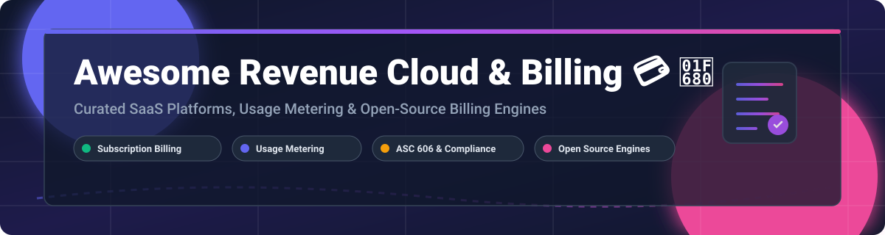

# Awesome Revenue Cloud & Billing 💳 🚀

  
  
  
  
  
  

  

## 🌟 Overview & Market Ecosystem

Welcome to the ultimate curated directory of **Revenue Cloud, Subscription Billing Platforms, Usage Metering Engines, CPQ (Configure, Price, Quote), and Revenue Recognition Infrastructure**.

Whether you are scaling an enterprise SaaS platform, monetizing LLM tokens in AI applications, or searching for self-hosted open-source billing engines, this guide categorizes top commercial SaaS services and open-source GitHub projects.

**Key Categories Covered**:
- 📈 **SaaS Revenue Cloud & Subscription Billing**: Managed enterprise platforms for automated invoicing, quote-to-cash, and subscription lifecycle management.
- ⚡ **Open-Source Metering & Billing Engines**: Self-hosted, API-first consumption tracking engines built for high-throughput usage-based billing.
- 🔀 **Payment Orchestration & Revenue Operations**: Payment routing across 120+ gateways, automated reconciliation, and ASC 606 revenue recognition.

---

## 📑 Table of Contents

- [🏢 SaaS & Hosted Billing Platforms](#-saas--hosted-billing-platforms)
- [🔓 Open-Source GitHub Projects](#-open-source-github-projects)
- [🤝 How to Contribute](#-how-to-contribute)
- [⭐ Star History](#-star-history)
- [💖 Support & Sponsorship](#-support--sponsorship)
- [⚠️ Disclaimer & Compliance](#%EF%B8%8F-disclaimer--compliance)

---

## 🏢 SaaS & Hosted Billing Platforms

> 💡 **Market Overview**: The global subscription billing and revenue management market is valued at **~$7.5B–$8.5B (2025)** and projected to reach **$18B–$36B by the early 2030s**. The market is **moderately fragmented**, comprising established enterprise CRM/ERP leaders and specialized revenue platforms, with low risk of a single winner-take-all outcome due to diverse industry billing requirements.

| SaaS Platform | Key Focus & Strengths | Company Size (Valuation / Revenue) | Starting Pricing Tier | Free Tier / Trial Limit |
| :--- | :--- | :--- | :--- | :--- |
| ☁️ **[Salesforce Revenue Cloud](https://www.salesforce.com/)** | Native CPQ, subscription billing, & revenue recognition on Salesforce | **$189B Market Cap** ($41.5B ARR) | Custom quote (CPQ starts ~$75/user/mo) | 30-day free trial of Salesforce Enterprise |
| 💳 **[Stripe Billing](https://stripe.com/billing)** | Developer-first subscription & usage billing integrated with payments | **$159B Valuation** (~$6.8B Revenue) | 0.5%–0.8% of billing volume | Free tier: First $1M in recurring volume processed free |
| 🐝 **[Chargebee](https://www.chargebee.com/)** | Subscription management, usage-based billing, ML dunning | **$3.5B Valuation** (~$200M ARR) | Starter tier: ~$599/mo | 14-day free trial (also free Starter tier up to $250k billing) |
| 🔄 **[Zuora](https://www.zuora.com/)** | Enterprise subscription economy platform & financial ops | **$1.7B Valuation** (Acquired by Silver Lake; ~$450M ARR) | Enterprise custom quote | No public free tier; interactive sandbox demo by request |
| 🤝 **[DealHub](https://dealhub.io/)** | Unified CPQ, contract management, and subscription billing | **~$184.5M Total Funding** (Acquired Subskribe) | Custom quote based on modules | No free trial; live demo & proof-of-concept (POC) by request |
| 📊 **[BillingPlatform](https://billingplatform.com/)** | Enterprise revenue lifecycle management & complex billing logic | **~$104M Total Funding** (~$25M ARR) | Enterprise custom quote | Guided demo / evaluation sandbox by request |
| 📈 **[Maxio](https://www.maxio.com/)** | Financial operations & billing for scaling B2B SaaS (Chargify+SaaSOptics) | **~$18.8M Total Funding** (~$50M ARR) | Grow Plan: $599/mo | Free developer sandbox ("Build" plan) with test APIs |
| 🔁 **[Recurly](https://recurly.com/)** | Automated subscription billing, invoicing, and churn recovery | **~$39.2M Total Funding** (~$50M ARR) | Starter Plan: $249/mo + 0.9% volume | 90-day free trial on Starter plan |
| 📝 **[Subskribe](https://www.subskribe.com/)** | Modern CPQ and subscription billing (integrated into DealHub) | **~$18.4M Total Funding** (Acquired by DealHub) | Enterprise custom quote | Demo by request (integrated into DealHub) |

---

## 🔓 Open-Source GitHub Projects

Below is a curated list of open-source subscription billing engines, event metering platforms, payment orchestrators, and invoicing software. Repositories are **sorted in descending order by GitHub Stars_Count**, each featuring a social-style badge linking directly to the repository's stargazers page.

- 🔀 **[Hyperswitch](https://github.com/juspay/hyperswitch)**   
  **Open-source payment orchestration platform from Juspay**, Apache-2.0 licensed. Connects to 120+ payment processors through a single API. Features intelligent routing, revenue recovery via retries, PCI-compliant card vault, and automated reconciliation.

- 🧾 **[Invoice Ninja](https://github.com/invoiceninja/invoiceninja)**   
  **Leading open-source invoicing, recurring billing, and time-tracking app**, AGPL-3.0 licensed built with Laravel & Flutter. Ideal for freelancers, agencies, and small businesses needing self-hosted invoicing.

- 📊 **[Lago](https://github.com/getlago/lago)**   
  **Open-source metering and usage-based billing API**, AGPL-3.0 licensed built in Go for high-volume event ingestion. Designed for AI, cloud, and API companies needing flexible consumption tracking and revenue analytics.

- 🗄️ **[IDURAR ERP/CRM](https://github.com/idurar/idurar-erp-crm)**   
  **Open-source ERP and CRM with integrated billing and accounting**, MIT licensed built on Node.js/React. Supports invoice management, recurring payments, customer management, and financial reporting.

- 🧱 **[Wallos](https://github.com/ellite/Wallos)**   
  **Open-source personal subscription and recurring expense tracker**, GPL-3.0 licensed. Modern self-hosted web app deployable via Docker to track recurring costs and billing notifications.

- ⚡ **[Kill Bill](https://github.com/killbill/killbill)**   
  **The leading enterprise open-source subscription billing and payments platform**, Apache-2.0 licensed with **15+ years of production use**. Features XML catalogs, multi-phase subscription engine with proration, plugin architecture for tax/ERP, and Kaui admin UI.

- 🤖 **[Autumn](https://github.com/useautumn/autumn)**   
  **Simple Stripe integration layer for AI startups**, Apache-2.0 licensed. Build pricing plans in 30 minutes with 3 simple functions, zero webhooks, usage tracking, credits, and feature entitlement controls.

- 💰 **[Paymenter](https://github.com/Paymenter/Paymenter)**   
  **Open-source billing and client management software**, MIT licensed built with Laravel. Specially crafted for web hosting providers, game server hosting, and digital service businesses.

- 🚀 **[Crater](https://github.com/crater-invoice-inc/crater)**   
  **Open-source web and mobile invoicing app for individuals and small businesses**, GPL-3.0 licensed built with Laravel and Vue.js. Features invoice creation, expense tracking, and estimation workflows.

- 🧪 **[Lotus](https://github.com/uselotus/lotus)**   
  **Open-source pricing and packaging infrastructure**, Python-based. Designed for product and growth teams to rapidly launch, experiment with, and scale complex subscription and usage-based billing models.

- 🧠 **[OpenMeter](https://github.com/openmeterio/openmeter)**   
  **Real-time usage metering engine for AI, agentic, and DevTool monetization**, Apache-2.0 licensed. Tracks CloudEvents, LLM token costs, prepaid credits, and graduated pricing with Kafka, ClickHouse, and Go.

- 🦀 **[Meteroid](https://github.com/meteroid-oss/meteroid)**   
  **Rust-based open-source usage metering and billing platform**, AGPL-3.0 licensed. Designed for high throughput and ultra-low latency event ingestion in product-led growth companies.

- 💸 **[FlexPrice](https://github.com/flexprice/flexprice)**   
  **Open-source pricing and billing infrastructure**, AGPL-3.0 licensed. Supports flexible billing models from subscription to usage-based pricing, prepaid credits, and no-code UI configuration.

- 📄 **[SolidInvoice](https://github.com/SolidInvoice/SolidInvoice)**   
  **Open-source invoicing solution for small businesses**, MIT licensed built with Symfony. Features automated invoice generation, client management, and multi-currency payment gateway integrations.

- 🐻 **[Billabear](https://github.com/billabear/billabear)**   
  **Open-source subscription management and billing platform**, AGPL-3.0 licensed. Integrates with Stripe to handle complex billing workflows, tax management, and customer self-service portals.

- 📒 **[Recurso](https://github.com/recurso-dev/recurso)**   
  **Open-source billing engine with built-in double-entry financial ledger**, MIT licensed built in Go & PostgreSQL. Supports ASC 606 revenue recognition, bandit-retry dunning, and India GST depth.

- 🐝 **[UniBee](https://github.com/UniBee-Billing/unibee)**   
  **Open-source universal billing software for SaaS**, AGPL-3.0 licensed. Community and enterprise versions supporting subscription management, billable metrics, and Docker Compose deployment.

- 💎 **[Laravel Cashier](https://github.com/laravel/cashier-stripe)**   
  **Official Laravel subscription billing integration for Stripe**, MIT licensed. Expressive interface for managing subscription billing, coupons, swapping subscriptions, and trial periods.

---

## 💡 Architectural Best Practices

When assembling a custom **Revenue Cloud & Billing Stack**:
- 🛠️ **Subscription Billing & Catalogs**: Use **Kill Bill** or **Laravel Cashier** for structured recurring plans, trials, and catalog management.
- ⚡ **Real-Time Usage Metering**: Pair **Lago**, **OpenMeter**, or **Meteroid** for high-volume CloudEvent ingestion and LLM token billing.
- 🔀 **Payment Orchestration**: Route payments through **Hyperswitch** to reduce processor fees, prevent churn, and increase authorization rates across 120+ processors.
- 📒 **Revenue Recognition & Compliance**: Implement **Recurso** or integrate with accounting systems (ASC 606 / IFRS 15) for revenue schedules and tax compliance (GST / VAT / Sales Tax).

---

## 🤝 How to Contribute

Contributions are welcome and appreciated! To add a new platform or update an existing entry:

1. 🍴 **Fork the Repository**.
2. 📝 **Edit `README.md`** following the existing table or list format.
3. 🔍 **Verify Details**: Ensure descriptions are factual, link to official sites or repositories, and include exact license / Stars_Count details.
4. 🚀 **Submit a Pull Request** with a short summary of changes.

Also check out our meta-list: [Awesome-Awesome-Awesome](https://github.com/ishandutta2077/Awesome-Awesome-Awesome).

---

## ⭐ Star History

---

## 💖 Support & Sponsorship

If you found this repository helpful, please consider supporting the project:

- ⭐ **Star this repository** to help others discover it on GitHub.
- 🍴 **Fork and share** it with your network, team, or developer community.
- ☕ **Buy me a coffee**: Support ongoing open-source curation and development via [GitHub Sponsors](https://github.com/sponsors/ishandutta2007).

  

Thank you for supporting open-source software! 🙌

---

## ⚠️ Disclaimer & Compliance

- This list is **community-curated** for informational purposes and does not constitute financial or legal advice.
- **Financial Compliance**: Revenue cloud platforms handle sensitive payment data and must comply with PCI-DSS, VAT/GST tax rules, and revenue recognition standards (ASC 606 / IFRS 15).
- **License Compliance**: Always check project license terms (Apache-2.0, MIT, AGPL-3.0, GPL-3.0) before deploying open-source engines in commercial production environments.
